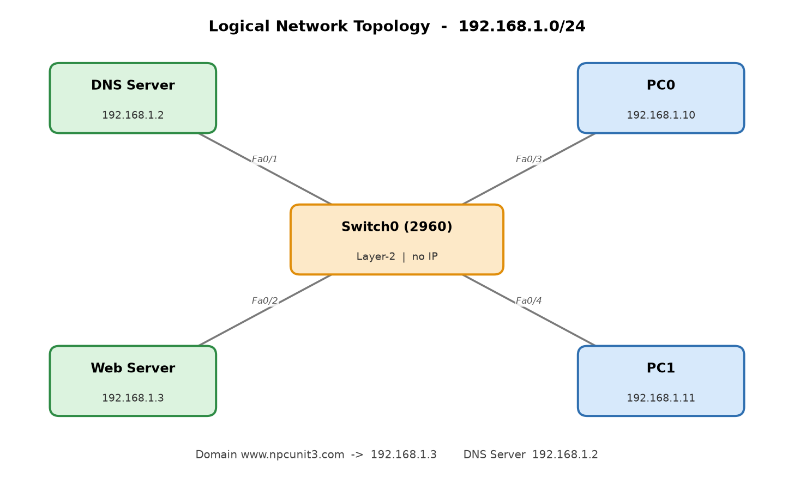
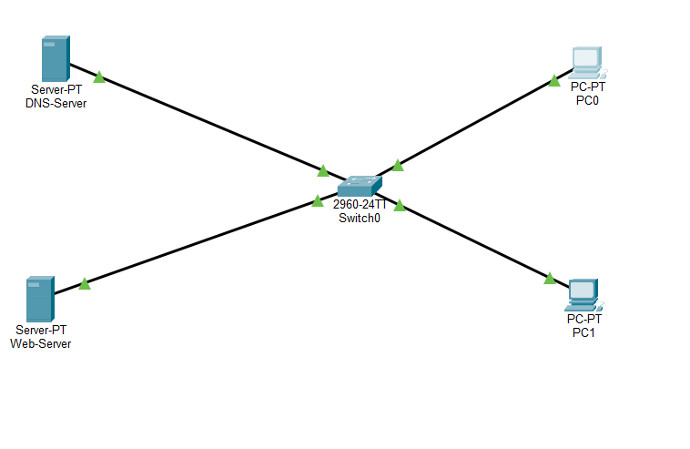
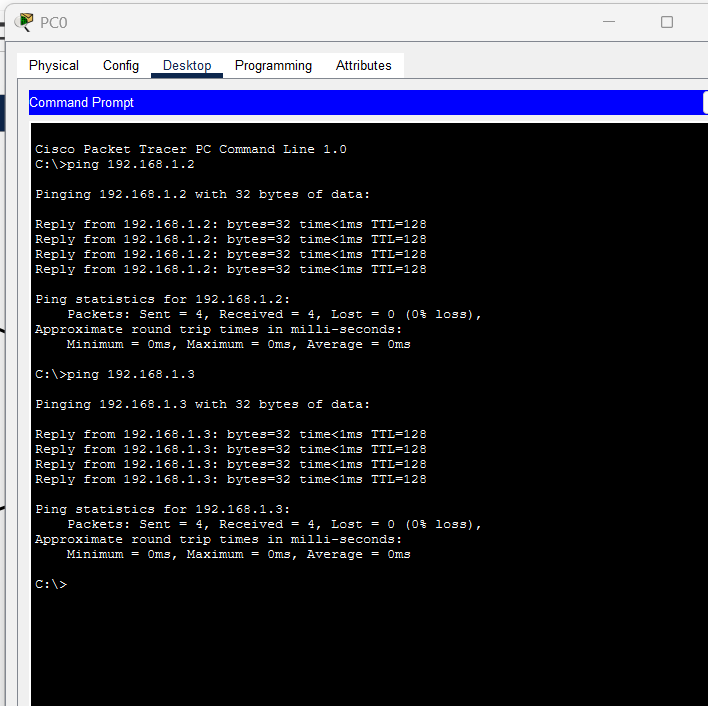
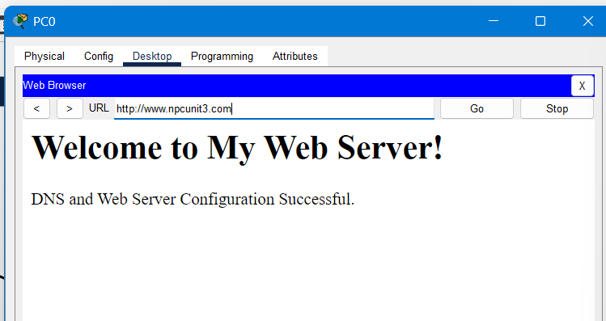
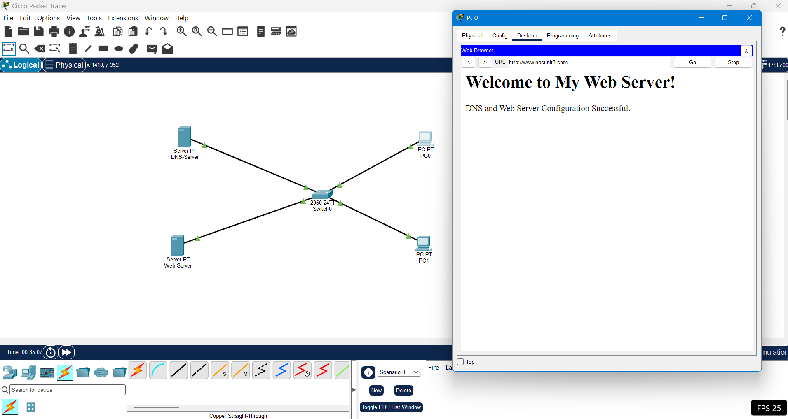

# NPC – Unit 3: Configure a DNS Server and Web Server Using Cisco Packet Tracer

Practical assignment for the **Networking Protocols & Communication (NPC)** course.

| Field | Details |
|---|---|
| **Author** | Yash Kawade |
| **PRN** | 2125UCSM1118 |
| **Department** | Cyber Security |
| **Semester** | 3rd Semester (Second Year) |
| **Subject** | Networking Protocols & Communication (NPC – Unit 3) |
| **College / University** | Sanjivani University, Kopargaon |
| **Repository** | [CONFIGURE-A-DNS-SERVER-AND-WEB-SERVER-USING-CISCO-PACKET-TRACER](https://github.com/kawdeyash/CONFIGURE-A-DNS-SERVER-AND-WEB-SERVER-USING-CISCO-PACKET-TRACER) |

---

## 1. Aim and Objectives

### Aim
To configure a DNS Server and a Web Server using Cisco Packet Tracer and access a website through its domain name (`www.npcunit3.com`) instead of its IP address.

### Objectives
1. Create a network topology using client PCs, a Layer-2 switch, a DNS Server, and a Web Server.
2. Assign static IPv4 addresses and subnet masks to all devices.
3. Configure and enable the HTTP service on the Web Server.
4. Configure the DNS service and create an **A (Address) record** mapping `www.npcunit3.com` to `192.168.1.3`.
5. Configure the client PCs with the DNS Server IP address (`192.168.1.2`) for domain name resolution.
6. Verify end-to-end IP reachability using ICMP `ping` commands.
7. Successfully access the hosted website through the web browser on client PCs using the domain name.

---

## 2. Hardware and Software Requirements

| Component | Model / Specification | Role in Topology |
|---|---|---|
| **Simulation Software** | Cisco Packet Tracer (v9.0+) | Network design, simulation, and packet flow analysis |
| **Switch** | Cisco 2960-24TT (Switch0) | Central Layer-2 device connecting all LAN nodes |
| **DNS Server** | Server-PT (DNS Server) | Resolves domain names to IP addresses via DNS A record |
| **Web Server** | Server-PT (Web Server) | Hosts HTML content and serves web pages over HTTP |
| **Client PCs** | 2 × PC-PT (PC0, PC1) | End devices sending DNS queries and requesting web pages |
| **Cabling** | Copper Straight-Through Cables | FastEthernet connections between dissimilar network devices |

---

## 3. Network Topology

The network is deployed as a single Local Area Network (LAN) on subnet `192.168.1.0/24`. All devices connect directly to **Switch0** via FastEthernet interfaces. Because all nodes reside in the same broadcast domain, intra-subnet communication occurs directly at Layer-2 without requiring a default gateway or router.

### Logical Topology Diagram


### Cisco Packet Tracer Implementation


---

## 4. IP Addressing Scheme

| Device | Interface | IP Address | Subnet Mask | Default Gateway | DNS Server |
|---|---|---|---|---|---|
| **DNS Server** | FastEthernet0 | `192.168.1.2` | `255.255.255.0` | N/A | N/A |
| **Web Server** | FastEthernet0 | `192.168.1.3` | `255.255.255.0` | N/A | N/A |
| **PC0** | FastEthernet0 | `192.168.1.10` | `255.255.255.0` | N/A | `192.168.1.2` |
| **PC1** | FastEthernet0 | `192.168.1.11` | `255.255.255.0` | N/A | `192.168.1.2` |

---

## 5. Configuration Steps

### 5.1 DNS Server Configuration
1. Open **DNS Server** → navigate to **Desktop** → **IP Configuration**.
2. Assign static IP `192.168.1.2` with subnet mask `255.255.255.0`.
3. Navigate to **Services** → **DNS**.
4. Set DNS Service to **ON**.
5. Add a new Resource Record:
   - **Name:** `www.npcunit3.com`
   - **Type:** `A Record`
   - **Address:** `192.168.1.3`
6. Click **Add** to save the entry.

### 5.2 Web Server Configuration
1. Open **Web Server** → navigate to **Desktop** → **IP Configuration**.
2. Assign static IP `192.168.1.3` with subnet mask `255.255.255.0`.
3. Navigate to **Services** → **HTTP**.
4. Ensure **HTTP** and **HTTPS** services are toggled to **ON**.
5. Edit `index.html` with the landing page:
```html
<html>
<head>
    <title>NPC Unit 3</title>
</head>
<body>
    <h1>Welcome to My Web Server!</h1>
    <p>DNS and Web Server Configuration Successful.</p>
</body>
</html>
```
6. Click **Save** to apply changes.

### 5.3 Client PC Configuration
1. Open **PC0** and **PC1** → go to **Desktop** → **IP Configuration**.
2. Configure static IP addresses:
   - **PC0:** `192.168.1.10`, Mask: `255.255.255.0`, DNS: `192.168.1.2`
   - **PC1:** `192.168.1.11`, Mask: `255.255.255.0`, DNS: `192.168.1.2`

---

## 6. Verification and Testing

### 6.1 ICMP Reachability Test
From **PC0 Command Prompt**, execute ping commands to verify connectivity:
```shell
ping 192.168.1.2
ping 192.168.1.3
```
**Observation:** Both pings returned `4 of 4 packets received (0% loss)` with `time < 1ms, TTL = 128`.



### 6.2 DNS Resolution & HTTP Web Access
1. On **PC0**, open **Desktop** → **Web Browser**.
2. Enter the URL: `http://www.npcunit3.com` and press **Go**.
3. **Result:** The browser successfully queries the DNS server (`192.168.1.2`), resolves `www.npcunit3.com` to `192.168.1.3`, and fetches the web page over HTTP.



### 6.3 Complete Simulation Workspace


---

## 7. Troubleshooting

| Issue | Root Cause | Solution |
|---|---|---|
| Domain does not resolve (`Host Name Unresolved`) | DNS service OFF or missing A record | Verify DNS service is set to ON and `www.npcunit3.com` points to `192.168.1.3`. |
| Cannot access website | HTTP service is disabled | Ensure HTTP service is turned ON in Web Server services. |
| Ping request times out | Incorrect IP or cable type | Verify correct static IP assignment and Copper Straight-Through cabling. |
| Browser cannot locate server | Missing DNS IP on PC | Ensure PC's DNS Server field is populated with `192.168.1.2`. |

---

## 8. Repository Files

| File | Description |
|---|---|
| [`NPC_Unit_3_Yash_Kawade.pdf`](NPC_Unit_3_Yash_Kawade.pdf) | Complete submission report in PDF format |
| [`NPC_Unit_3_Yash_Kawade.docx`](NPC_Unit_3_Yash_Kawade.docx) | Editable submission report document |
| [`NPC_Unit_3_DNS_Web_Server.pkt`](NPC_Unit_3_DNS_Web_Server.pkt) | Cisco Packet Tracer 9.0 simulation file |
| [`logical_topology.png`](logical_topology.png) | High-resolution logical network topology diagram |
| [`screenshots/`](screenshots/) | Captured Packet Tracer screenshots for verification |

---

## 9. Conclusion
The practical demonstrates the complete process of establishing a DNS server and Web server in Cisco Packet Tracer. By leveraging DNS A records, clients on the local network can access web services using human-friendly domain names rather than remembering numerical IP addresses, simulating real-world TCP/IP client-server communications.
